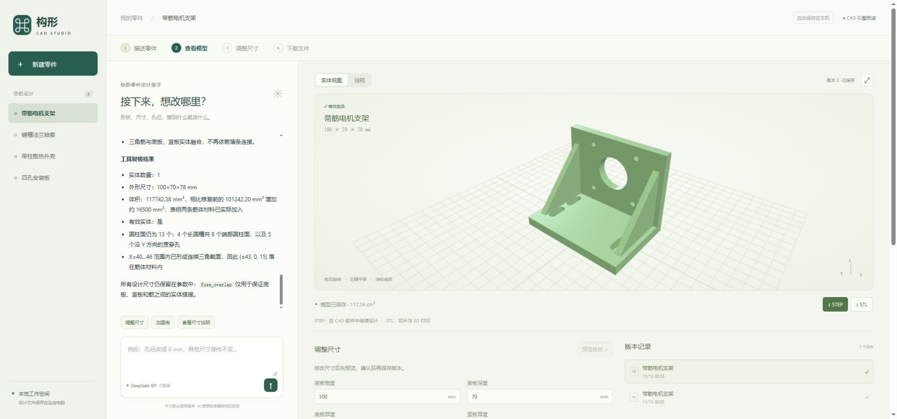

# 构形 CAD

**用聊天描述一个机械零件，在网页里查看、修改，再下载 CAD 文件。**

当前是单人、本机运行的第一版。先用安装板、支架、外壳这类简单零件了解流程。

## 先用起来

1. 双击根目录的 **`start.cmd`**，会启动并打开构形 CAD。如果已经运行，会直接打开现有工作台。
2. 网页地址：**http://127.0.0.1:3090**。
3. 点击“新建零件”，描述形状和尺寸，或选择一个示例。
4. 模型生成后，可以继续聊天修改；也可以编辑尺寸，点击“预览修改”，再保存或取消。
5. 满意后下载 STEP、STL 或建模源码。

可以先试这句话：

> 生成一块 80×40×5 mm 的安装板，四角各一个直径 6 mm 的通孔，孔中心距相邻边各 8 mm。

然后再说：

> 孔径改成 8 mm，板厚改成 8 mm，其他不变。

当前已经保留一份“四孔安装板”演示项目，可直接回看已保存的版本。

## 从 GitHub 安装

仓库：[satoko5793/dsh-cad](https://github.com/satoko5793/dsh-cad)。当前以 Windows 为主要运行环境。

先安装 Git、Node.js 24.9 或更新版本，以及 Python 3.13（确保 `py -3.13` 可用），然后执行：

```powershell
git clone https://github.com/satoko5793/dsh-cad.git
cd dsh-cad
npm run setup
npm run dsh -- web
```

在原版 DSH 网页中配置自己的 DeepSeek API；已在本机配置过的可继续复用。另开终端，在仓库根目录执行：

```powershell
npm run samples:import
npm start
```

示例导入会保留已有项目，不覆盖本地修改。仓库不包含 API 密钥、Python 环境、Node 依赖、临时预览或完整的私人设计目录。

## 复杂零件实测

2026-11-13 已通过 DSH 实际生成带筋电机支架、带柱散热外壳和键槽法兰轴套。最终均为有效单实体；84 项 STEP 重新导入与关键孔槽、材料位置检查通过。支架首版缺筋，经过对话修正后通过；这个前后对照也已保留。

[查看示例、下载 STEP/STL 和检查明细](samples/README.md)。工作台导入后共有 4 个示例项目、8 个保存版本，可继续聊天和改参数。



## 后续更新

修改完成后，在根目录运行：

```powershell
npm run repo:update -- "说明这次修改"
```

此命令会运行测试、更新明确选中的示例、复查复杂模型、检查暂存文件并提交推送到 `main`。如果远端有未合并更改、测试失败或发现疑似凭据，会停止。需要已有的 GitHub 推送权限；不会自动注册账号或保存新凭据。

`npm run samples:export` 只导出 `samples/projects.json` 选中的四个示例。新的个人项目不会自动进入仓库。若修改了这些样例的需求或特征，也应同步更新 `samples/verify-complex.py` 中的验收条件及示例说明。

## 只需要先理解这三部分

| 部分 | 做什么 | 在哪里 |
|---|---|---|
| 网页工作台 | 对话、3D 预览、参数和版本记录 | `cad-studio/public/` |
| DeepSeek Harness | 使用你已配置的 DeepSeek API 理解需求、调用建模工具、修复失败 | `cad-studio/harness.mjs` 和 `cad-plugin.mjs` |
| CAD 引擎 | 根据建模脚本生成真实实体，检查几何并导出 | `cad-studio/runner.py` |

流程是：**描述需求 → DSH 写建模脚本 → CAD 引擎执行 → 网页展示 → 继续修改。**

## 文件放在哪里

```text
dsh/
├─ start.cmd             平时用这个：打开构形 CAD
├─ start-harness.cmd     原版 DSH 界面，进阶时再看
├─ README.md             先读这一页
├─ cad-studio/           我们自己的应用源码
│  ├─ .data/             你的设计、聊天、参数、版本和导出文件
│  ├─ public/            网页界面
│  ├─ test/              建模与工具接口测试
│  └─ README.md          安装和开发说明
├─ research/             其他软件的调研、源码和实测证据
├─ samples/              下载的 CAD 示例
├─ vendor/               之前安装的第三方查看器插件包
└─ node_modules/         已安装的 DSH 依赖
```

**设计数据最重要的是 `cad-studio/.data/`，备份整个目录即可。** 目前密钥由 DSH 保存，不需要放进网页代码或项目文件。

## 当前做到哪一步

- 已跑通：对话生成、对话修改、3D 预览、参数修改预览/保存/取消、版本回看、STEP/STL/源码下载。
- 已验证：四孔安装板的尺寸、体积、孔径与孔中心；相关自动测试通过。
- 还没做：可编辑特征树、装配约束、二维工程图、多用户和云端部署。
- 生成成功代表 CAD 实体有效；不代表已经验证强度、公差或可制造性。

后续先把简单零件的生成与修改做稳定，再考虑特征树、点选修改等功能。

## 两个入口不要混淆

| 入口 | 用途 | 地址 |
|---|---|---|
| `start.cmd` / `npm start` | 我们自己的构形 CAD，日常使用 | http://127.0.0.1:3090 |
| `start-harness.cmd` / `npm run harness` | 原版 DSH，用于了解框架和插件 | 默认 http://127.0.0.1:3080，以终端打印的带 token 地址为准 |

保持启动的终端窗口打开；关闭它会停止这次启动的服务。

想了解其他方案，看 [调研记录](research/README.md)。需要安装、测试或修改代码时，再看 [开发说明](cad-studio/README.md)。
