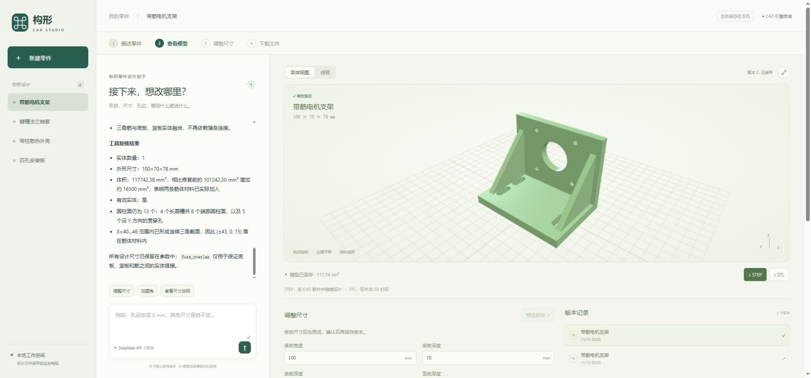

# 保留的网页 / CadQuery 原型

原来的产品思路和实现继续保留：用户通过对话生成参数化 CadQuery 模型，在网页中查看多组件、悬停高亮/分离，调整参数、比较版本并下载 STEP/STL/Python。它不操作桌面 FreeCAD。

当前产品主线是 [`desktop/`](../desktop/README.md) 的桌面 Harness + 专业 CAD。两端只共用 [`shared/`](../shared/README.md) 的 DSH 传输与独立 Node 检测，原型默认路径、数据及功能保留。

在仓库根目录运行 `npm run start:web`，或双击 `start-web.cmd`，访问 `http://127.0.0.1:3090`。原型依赖及 Python 环境见[使用指南](../docs/usage.md)。`npm run samples:import` 导入四个已选公开项目，已有同 ID 项目保留。

可以先说“做一个四孔安装板”，再说“孔径改成8毫米，其他不变”；多模块模型可选中组件后继续对话。原型设计与版本保存在本目录 `.data/`，不自动转换为桌面原生工程；删除或迁移程序前先备份。

- [原型代码、数据和运行边界](../docs/prototype.md)
- [验证记录与能力限制](../docs/validation.md)
- [开发与提交约定](../docs/development.md)
- [产品目标与长期制作方向](../docs/product.md)
