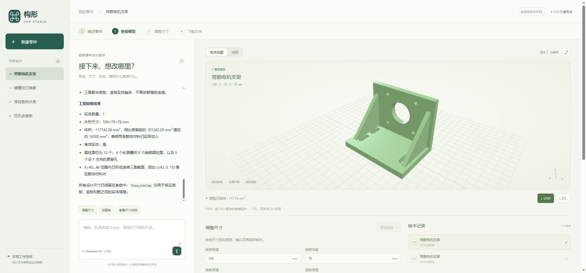

# 保留的网页与 CadQuery 原型

原有思路继续保留：对话生成参数化脚本 → CadQuery 构建 → 网页组件预览/参数修改/版本比较 → STEP/STL 导出。它是独立原型，当前产品主线是[桌面 Harness](architecture.md)。两端共用 [DSH 运行时](../shared/README.md)，设计数据不自动互转。

根目录运行 `npm run start:web` 或双击 `start-web.cmd`。`npm run samples:import` 可导入四个已选公开项目（八个保存版本），已有同 ID 项目保留。安装、路由与备份见[使用指南](usage.md)，开发和公开示例更新见[开发指南](development.md)。

## 代码入口

| 文件或目录 | 作用 |
|---|---|
| [`scripts/start-cad.mjs`](../scripts/start-cad.mjs) | 检查现有服务、启动应用、可选打开浏览器 |
| [`cad-studio/public/`](../cad-studio/public/) | 聊天、STL预览、模块列表、参数与版本界面 |
| [`cad-studio/public/viewer.js`](../cad-studio/public/viewer.js) | 独立组件网格、射线拾取、边缘高亮、隔离和分离视图 |
| [`cad-studio/public/viewer-math.js`](../cad-studio/public/viewer-math.js) | 组件配色与只影响显示的分离位移 |
| [`cad-studio/server.mjs`](../cad-studio/server.mjs) | 项目API、任务状态、SSE事件流与下载 |
| [`cad-studio/harness.mjs`](../cad-studio/harness.mjs) | 原型默认路径/profile封装，共享运行时负责DSH子进程与JSON-RPC |
| [`cad-studio/prompt.txt`](../cad-studio/prompt.txt) | 需求理解、口语修改、参数化和回复约定 |
| [`cad-studio/cad-plugin.mjs`](../cad-studio/cad-plugin.mjs) | 注册唯一建模工具 `cad_build`，限制Agent工具范围 |
| [`cad-studio/build.mjs`](../cad-studio/build.mjs) | Python worker、参数验证、预览和版本提交 |
| [`cad-studio/runner.py`](../cad-studio/runner.py) | 脚本检查、实体构建、测量和STEP/STL输出 |
| [`cad-studio/public/parameters.js`](../cad-studio/public/parameters.js) | 前后端共用的参数名称、单位与验证规则 |

## 两条建模路径

对话路径：浏览器提交需求与选中版本 → 服务端补充项目ID、选中脚本/参数和必要的最近对话 → DSH通过 `cad_build` 生成或修改 → worker验证并导出 → 保存新版本 → SSE通知前端。模型服务在首次对话时启动，密钥由DSH管理。

参数路径：使用已有脚本与新参数运行worker → 生成独立预览 → 用户取消或提交。此路径不需要大模型；提交复用已检查的预览文件，同一预览重复保存不会重复创建版本。

每个项目通过忙碌状态防止并发修改；任务与DSH会话映射保存在进程内。服务重启后任务不会恢复执行，持久化的聊天与版本仍在，新对话会补入选中版本和最近上下文。

## 脚本与模块约定

可编辑尺寸放在数值字典 `params`，配套规格可给中文标签、单位、步长和实际约束。长度为mm，角度为°，数量为整数。工具参数是修改的权威来源，worker会移除脚本顶层重复声明的字面量 `params`。

单体脚本将最终 `cq.Workplane` 或 `cq.Shape` 赋给 `result`。多模块脚本可声明 `components={'底座':base,'滑台':carriage}`，字典包含1至24个命名模块，每个值是非空有效的CAD对象。`components` 存在时成为最终导出来源，组成Compound，不自动融合；每个模块可以包含多个实体。

`geometry` 包含总体尺寸、世界坐标边界、体积、表面积、面数、实体数和圆柱面测量。`geometry.components` 保存各模块名称、尺寸、边界、体积与实体数；旧单体脚本返回空模块列表。名称帮助对话定位，尚不是带连接约束的装配数据模型，也不承诺在STEP中保留独立命名装配树。

下载的Python源码包含参数和导出语句，多模块时按 `components` 重新组合，保持与worker导出来源一致。

## 组件视图与修改上下文

worker除整体STEP/STL外，还输出 `viewer.json` 与按序号命名的 `component-<序号>.stl`。前端独立加载每个组件，使用Three.js射线拾取真实网格，不以包围盒推断面片归属。模型悬停与组件列表联动，点击保持选择；边缘和表面高亮、只看选中、分离位移都不写回设计数据。

保存版本和预览分别通过 `/api/projects/<项目ID>/revisions/<版本ID>/viewer`、`/api/projects/<项目ID>/previews/<预览ID>/viewer` 提供组件清单；网格路径为同级 `components/<序号>.stl`。接口验证版本归属、预览有效期和组件序号。

旧版本缺少组件网格时，在该版本目录的 `.viewer/` 中用原脚本与参数重建显示缓存；同版本并发请求复用生成任务，不追加版本。缓存校验组件名称、尺寸和体积与保存测量一致。保存参数预览时同时复制已有组件视图文件。

对话可提交 `componentName`。服务端校验它属于选中版本，保存到用户消息并补入模型上下文；前端切换项目或版本会清除选择。该上下文用于指代理解，模型修改结果仍需检查，不构成对所有后续生成的行为保证。

## 数据与版本

默认目录为 `cad-studio/.data/<项目ID>/`，可用 `CAD_DATA_DIR` 切换到独立数据目录。

| 位置 | 内容 |
|---|---|
| `project.json` | 聊天、版本索引、当前版本及项目时间 |
| `revisions/<版本ID>/` | `revision.json`、`model.py`、`parameters.json`、STEP/STL，以及可选组件视图文件 |
| `previews/<预览ID>/` | 临时模型、预览元数据及原始版本关系 |
| `revisions/<版本ID>/.viewer/` | 旧版本可重建的组件显示缓存，非新增设计版本 |

项目JSON通过临时文件和重命名写入；它不是数据库事务系统。版本成功后追加，预览不直接修改原版本，30分钟后过期；过期并不代表文件已被后台自动清理。备份与迁移说明见[使用指南](usage.md)。

## 运行边界

服务固定监听 `127.0.0.1`，端口默认3090，可通过 `PORT` 指定。前端依赖由本地提供。模型路由与DSH配置见[使用指南](usage.md)。`CAD_PYTHON` 可覆盖worker解释器位置；当前健康检查及根目录启动依赖检查仍按默认 `.venv` 布局判断，不能仅凭自定义解释器就假设这些检查全部兼容。根目录启动器仍按默认3090探测和打开页面。

worker使用 `-I -X utf8`，保持Python隔离模式并明确管道编码。脚本有AST限制、有限内建函数、参数和几何检查、90秒超时；这些不构成操作系统级沙箱。保持本机单用户使用，后续若改变部署范围需要重新设计执行隔离与访问控制。

应用运行时检查实体有效性、非空实体、正体积及有限尺寸；不自动检查需求完整性、模块相交、连接配合、强度或制造工艺。独立验证脚本的结果不能当成所有新项目的自动检查能力。
